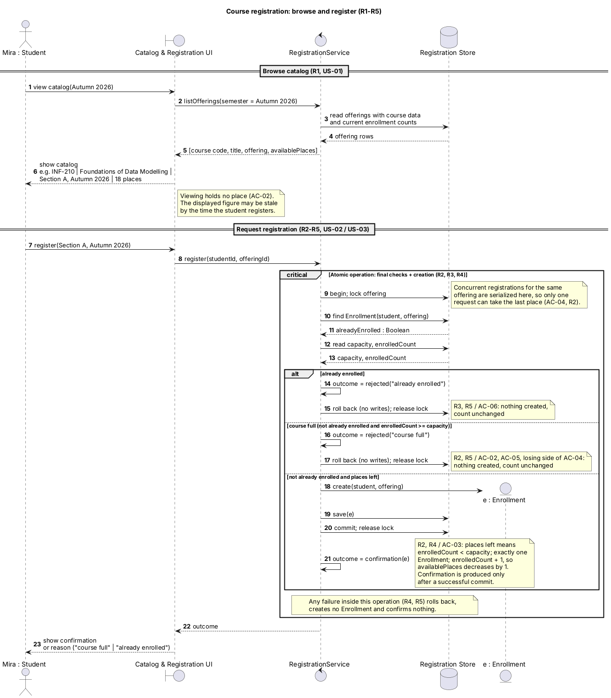
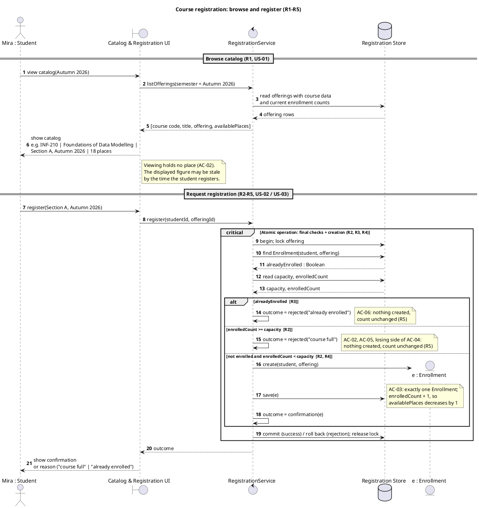
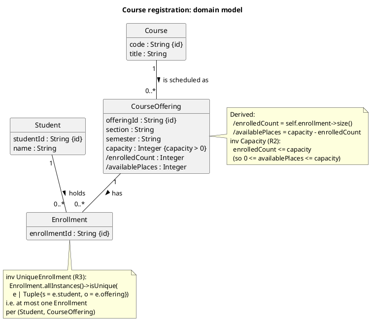
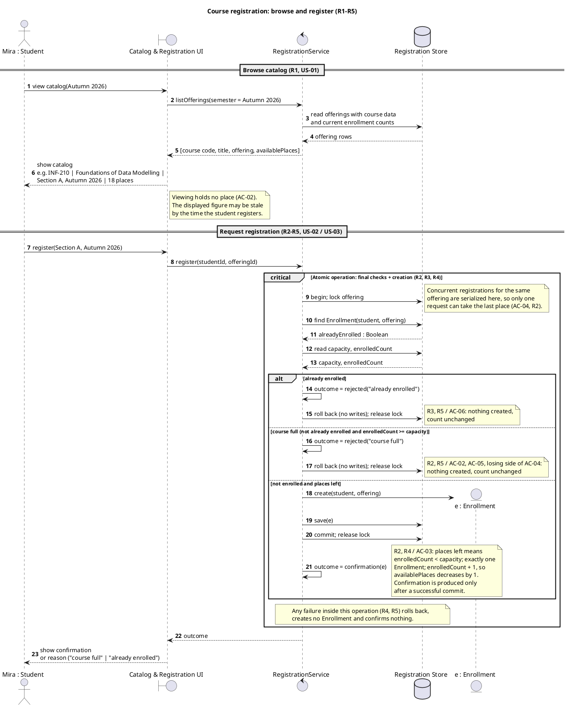
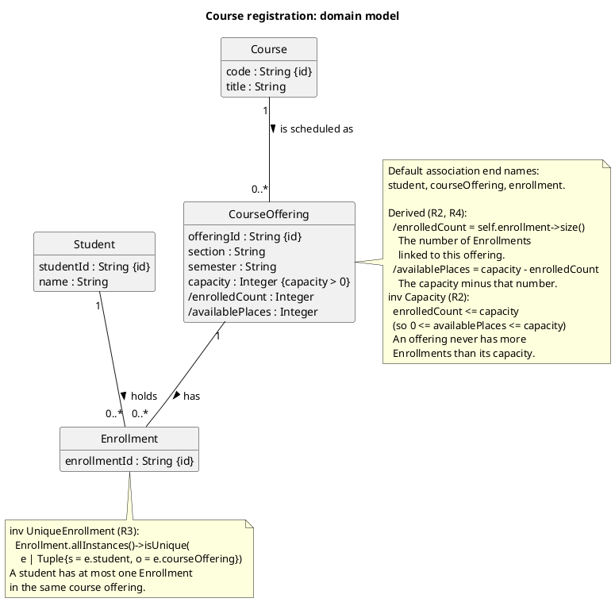
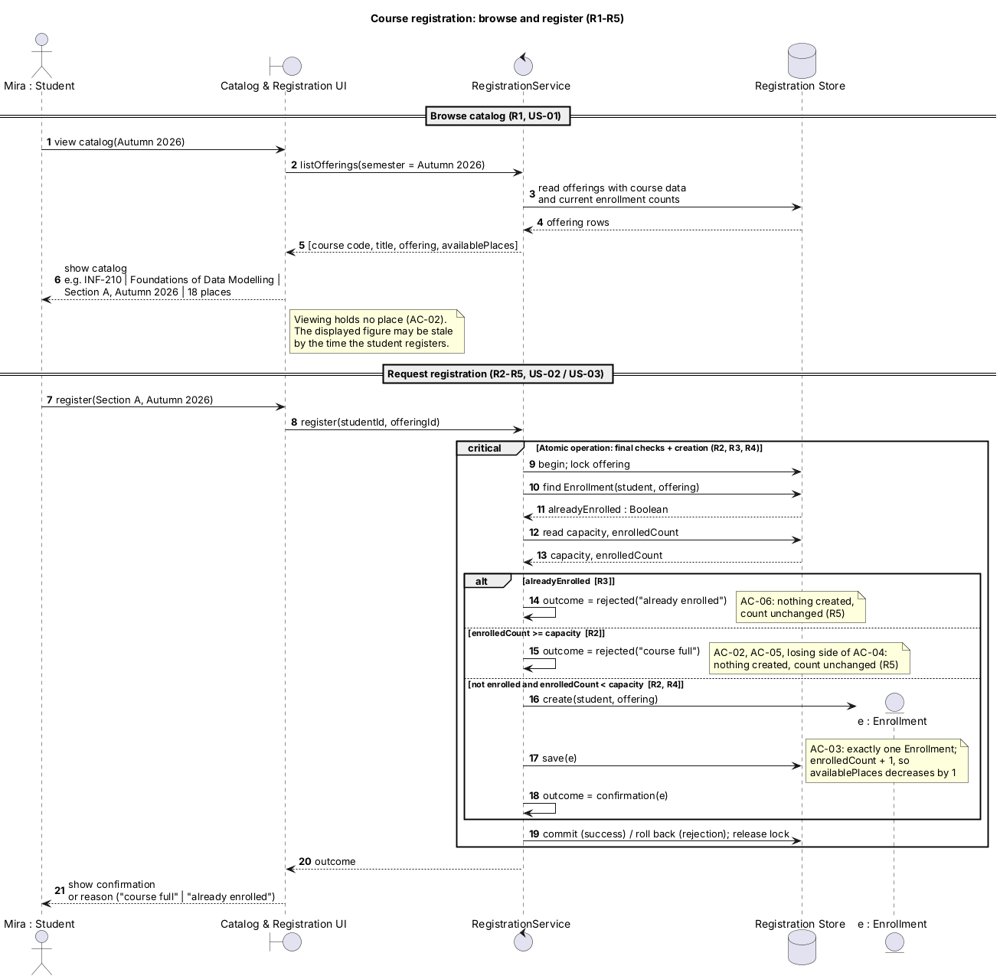
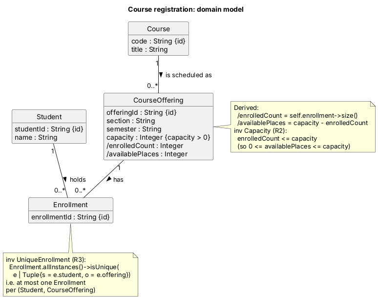

# SIS #02 — AI-Assisted UML Modeling: University Course Registration

<!--
  This is the only file you write your report in. README.md tells you what goes where.

  Rules the checker relies on:
  - Do not delete, rename or renumber the ## headings, the ### headings, or the **Label:** words.
  - Replace every "(write here)" and "(paste here)". None may be left when you submit.
  - Comments like this one are ignored by the checker and the word counter. Delete them or leave them.
-->

## 1. Scope and assumptions

<!-- Final version after reviewing Prompt A's output. Section 10 keeps the first version. -->

**Scope:** A signed-in student browses the catalog of course offerings for one semester, chooses one offering and requests registration; the system rechecks places, creates one Enrollment or rejects the request with a reason. Payments, prerequisites, timetable clashes, waiting lists and cancellation are out of scope.

**Assumptions:**

1. The student is signed in and the selected offering exists in the catalog.
2. Capacity is a positive whole number, and available places = capacity − current number of enrollments in that offering.
3. The catalog view only shows places; it reserves nothing. Places are checked again when the student registers.
4. The duplicate check, the capacity check and the creation of the Enrollment run as one atomic operation, so two requests can never take the same last place.
5. If a request is both a duplicate and for a full offering, the duplicate check runs first, so the student is told "already enrolled".
6. Offerings with 0 available places are still listed in the catalog, with 0 places shown.
7. R3 is only about the same offering; enrolling in a different offering of the same course is not restricted by these rules.
8. All students and courses are fictional (for example, students Mira Tal and Jonas Weller, course INF-210).

## 2. User stories and acceptance criteria

<!-- Approved requirements: Prompt A's draft after my review. -->

### US-01 — Browse offerings

**US-01:** As a signed-in student, I want to see the course offerings for one semester with their available places, so that I can choose an offering to register for.

- **AC-01** (R1): Given Section A of INF-210 in Autumn 2026 has capacity 30 and 12 enrollments, When Mira views the catalog for Autumn 2026, Then the entry shows the course code "INF-210", the title "Foundations of Data Modelling", the offering "Section A, Autumn 2026" and 18 available places.
- **AC-02** (R1, R2, R5): Given the catalog showed Section B with 1 available place to Mira, and Jonas then registered for that last place, When Mira requests registration for Section B, Then the system rechecks availability at registration time, rejects Mira's request with "course full", creates no Enrollment and the count stays at 2.

### US-02 — Register for an offering

**US-02:** As a signed-in student, I want to register for an offering that has a free place, so that I am enrolled and receive a confirmation.

- **AC-03** (R2, R4): Given Section A has capacity 30 and 12 enrollments and Mira is not enrolled in it, When Mira requests registration for Section A, Then exactly one Enrollment linking Mira and Section A is created, the count becomes 13, available places become 17 and Mira receives a confirmation.
- **AC-04** (R2, R4, R5): Given Section B has capacity 2 and 1 enrollment and neither Mira nor Jonas is enrolled in it, When Mira and Jonas request registration for Section B at the same time, Then exactly one of them gets an Enrollment and a confirmation, the other is rejected with "course full", and Section B ends with 2 enrollments, never more than its capacity.

### US-03 — Receive a clear rejection

**US-03:** As a signed-in student, I want to be told why my registration was rejected, so that I understand that I was not enrolled.

- **AC-05** (R2, R5): Given Section B has capacity 2 and 2 enrollments and Mira is not enrolled in it, When Mira requests registration for Section B, Then the request is rejected with the explanation "course full", no Enrollment is created and the count stays at 2.
- **AC-06** (R3, R5): Given Mira already has an Enrollment in Section A and Section A has 13 enrollments, When Mira requests registration for Section A again, Then the request is rejected with the explanation "already enrolled", no new Enrollment is created and the count stays at 13.

## 3. Sequence diagram

<!-- The FINAL diagram, rendered. -->



**Participants:** `Mira : Student` (actor) is the signed-in student. `Catalog & Registration UI` (boundary) is the screen that shows the catalog and passes the request on. `RegistrationService` (control) runs the use case and owns the atomic check-and-create step. `Registration Store` (database) stands for stored Courses, CourseOfferings and Enrollments and for the lock/transaction. `e : Enrollment` (entity) is the new Enrollment, created only on the success branch.

**Atomic operation:** the `critical` fragment "Atomic operation: final checks + creation" covers messages 9-21: 9 `begin; lock offering`, 10-11 the duplicate check `find Enrollment(student, offering)`, 12-13 the capacity check `read capacity, enrolledCount`, and on success 18 `create(student, offering)`, 19 `save(e)`, 20 `commit; release lock`. Rejections end with `roll back (no writes); release lock` (15, 17). The catalog view (messages 1-6) is outside this fragment and only reads data, so it reserves nothing; the note "Viewing holds no place" says this, and the counts are read again in message 12.

**Where the Enrollment is created:** message 18 `create(student, offering)` from `RegistrationService` to the new lifeline `e : Enrollment`, followed by 19 `save(e)` to `Registration Store`. It produces one object of the class `Enrollment` in section 4, linked to one `Student` and one `CourseOffering`.

**Technical lifelines:** `Catalog & Registration UI`, `RegistrationService` and `Registration Store` are not classes in the class diagram. They are technical lifelines (boundary, control and storage) that show who does what during the interaction. The class diagram is a domain model, so it shows only the concepts of the problem (Student, Course, CourseOffering, Enrollment) and not the screens, services or database that handle them. This difference in abstraction is normal: the sequence diagram shows behaviour at the design level, the class diagram shows the domain.

## 4. Class diagram

<!-- The FINAL diagram, rendered. -->


| Association | Read left to right | Read right to left |
| --- | --- | --- |
| Course "1" -- "0..*" CourseOffering : is scheduled as | One Course is scheduled as zero or more CourseOfferings | Each CourseOffering belongs to exactly one Course |
| Student "1" -- "0..*" Enrollment : holds | One Student holds zero or more Enrollments | Each Enrollment is held by exactly one Student |
| CourseOffering "1" -- "0..*" Enrollment : has | One CourseOffering has zero or more Enrollments | Each Enrollment belongs to exactly one CourseOffering |

**How an Enrollment links a student to an offering:** Enrollment is its own class between Student and CourseOffering. Its two associations both have multiplicity "1" on the Student and CourseOffering side, so every Enrollment connects exactly one Student with exactly one CourseOffering. A Student can hold many Enrollments (in different offerings) and an offering can have many Enrollments (from different students). The count of Enrollments of an offering is the derived attribute `/enrolledCount`, and `/availablePlaces = capacity - enrolledCount`.

**Capacity constraint:** `inv Capacity (R2): enrolledCount <= capacity` in the note on CourseOffering: an offering never has more Enrollments than its capacity. The multiplicity "0..*" on the Enrollment end cannot express this, because the upper limit is not a fixed number in the diagram; it is a different value (`capacity`) for each offering.

**Uniqueness constraint:** `inv UniqueEnrollment (R3)` in the note on Enrollment: a student has at most one Enrollment in the same course offering. Multiplicity alone cannot express this, because "0..*" on both sides only limits how many Enrollments one Student or one offering has; it says nothing about two Enrollments sharing the same (Student, CourseOffering) pair.

## 5. Traceability

| Rule and criterion | Model evidence | Validation case |
| --- | --- | --- |
| R1 + AC-01, AC-02 | Sequence messages 1-6: `view catalog(Autumn 2026)`, `listOfferings(semester = Autumn 2026)`, returned `[course code, title, offering, availablePlaces]`; note "Viewing holds no place". Class attributes `Course.code`, `Course.title`, `CourseOffering.semester`, `/availablePlaces` | No T case for R1. Extra check: I traced messages 1-6 with AC-01 (capacity 30, 12 enrolled) and the shown row has code, title, offering and 30 - 12 = 18 places |
| R2 + AC-02, AC-03, AC-04, AC-05 | Message 12 `read capacity, enrolledCount` inside `critical`; guard `course full (not already enrolled and enrolledCount >= capacity)`; note on lock (serialized requests); class note `inv Capacity (R2)` | T2, T3 |
| R3 + AC-06 | Message 10 `find Enrollment(student, offering)`; guard `already enrolled`; class note `inv UniqueEnrollment (R3)` | T4 |
| R4 + AC-03, AC-04 | Guard `not already enrolled and places left`; messages 18 `create(student, offering)`, 19 `save(e)`, 20 `commit; release lock`, 21 `outcome = confirmation(e)`; Enrollment "1" Student and "1" CourseOffering | T1, T2 |
| R5 + AC-02, AC-05, AC-06 | Messages 14 `rejected("already enrolled")` and 16 `rejected("course full")`, each followed by `roll back (no writes)`; message 23 shows the reason; no create or save in these branches | T3, T4 |

## 6. Walkthroughs

<!-- Walk each case through YOUR final sequence diagram, message by message. Column 2: the
     actual steps and the state change (count before → after). Column 3 starts with Pass or
     Fail, then the location: the message, guard or note where you saw it. A Fail you
     report honestly is a finding, not a penalty. -->

| Case | Observed path and state change | Judgment and evidence |
| --- | --- | --- |
| T1. Available | 7-8 register → 9 begin; lock offering → 10-11 alreadyEnrolled = false → 12-13 capacity = 2, enrolledCount = 0 → guard `not already enrolled and places left` (0 < 2) → 18 create(student, offering) → 19 save(e) → 20 commit; release lock → 21 outcome = confirmation(e) → 22 outcome → 23 show confirmation. Count changes 0 → 1, one free place is left. | Pass: guard `not already enrolled and places left`, messages 18-21. The note at 21 (R2, R4 / AC-03) confirms exactly one Enrollment, count + 1, and the confirmation only after the commit at 20. |
| T2. Last place | 7-8 register → 9 lock → 10-11 alreadyEnrolled = false → 12-13 capacity = 2, enrolledCount = 1 → guard `not already enrolled and places left` (1 < 2) → 18 create → 19 save → 20 commit; release lock → 21 confirmation(e) → 22-23. Count changes 1 → 2, no free places remain. | Pass: guard `not already enrolled and places left`, messages 18-21. The note at 9 (AC-04, R2): concurrent requests for this offering are serialized, so only one student gets the last place. |
| T3. Full | 1-6 the catalog showed a free place (note AC-02: viewing holds no place, the number may be stale) → 7-8 register → 9 lock → 10-11 alreadyEnrolled = false → 12-13 capacity = 2, enrolledCount = 2 → guard `course full (not already enrolled and enrolledCount >= capacity)` → 16 rejected("course full") → 17 roll back (no writes); release lock → 22 outcome → 23 reason "course full". Count stays 2, no Enrollment is created. | Pass: guard `course full (...)`, messages 16-17. The note at 17 (R2, R5 / AC-02, AC-05, losing side of AC-04): nothing created, count unchanged. |
| T4. Duplicate | 7-8 register → 9 lock → 10-11 alreadyEnrolled = true → 12-13 capacity and enrolledCount = 1 are read (they come before the alt) but do not decide → guard `already enrolled` → 14 rejected("already enrolled") → 15 roll back (no writes); release lock → 22 outcome → 23 reason "already enrolled". Count stays 1, no duplicate Enrollment is created. | Pass: guard `already enrolled`, messages 14-15. The note at 15 (R3, R5 / AC-06): nothing created, count unchanged. |

## 7. Review decisions

| AI suggestion or model element | Decision | Reason | Rule |
| --- | --- | --- | --- |
| Critique Defect 1: original guards `alreadyEnrolled [R3]` and `enrolledCount >= capacity [R2]` can both be true | Modified: guard 2 became `course full (not already enrolled and enrolledCount >= capacity)` | When a student is already enrolled in a full offering the reason must be one answer, so duplicate wins and the guards no longer overlap; I wrote it in words because the README says a guard starting with "not" is read as success | R3, R5 |
| Critique Defect 2: `outcome = confirmation(e)` came before `commit (success) / roll back (rejection)` | Accepted: commit moved into the success branch before the confirmation, roll back added to both rejection branches, failure note added | A student must never get a confirmation for an Enrollment that was not saved, so the confirmation has to come after the commit | R4, R5 |
| Critique Defect 3: OCL used `e.offering`, an end name that does not exist | Modified: kept the associations and multiplicities, changed the note to `e.courseOffering` and added the rule in plain words | The uniqueness note is the only place where R3 is stated in the class diagram, so it must use valid names and be readable | R3 |
| Critique minor point: rule IDs `[R3]` inside guard text | Accepted: rule IDs moved into notes, guards are plain conditions | The README warns that square brackets in guards break the rendering and make the rule look like the guard | R2, R3 |
| Critique optional 1: model Enrollment as an association class | Rejected | The assignment requires Enrollment as its own class, and it already links one Student and one CourseOffering with the uniqueness note | R3, R4 |
| Prompt D result, guard 3 `not enrolled and places left` | Modified by me: changed to `not already enrolled and places left` in models/sequence.puml | The AI itself flagged that the three guards used different words, so I made guard 3 use the same words as guards 1 and 2 | R3, R4 |

## 8. Modeling explanation

<!-- 200–300 words. Your main design choices; how the class diagram and the sequence diagram
     complement each other; why an activity diagram could also help explain the workflow. -->

The main decision is to keep Enrollment as its own class between Student and CourseOffering. A registration is a fact with its own rule, the uniqueness of the pair student and offering, which a plain many-to-many association cannot hold. The second decision is that free places are not stored but derived: `availablePlaces = capacity - enrolledCount`. So the number of places can never drift away from the real number of Enrollments, and it goes down by itself after each saved Enrollment (messages 19-20). The third decision is that the final checks and the creation of the Enrollment run in one `critical` block with a lock on the offering (messages 9-21). Concurrent requests wait in line, so only one student gets the last place (AC-04), and any failure rolls back with no writes (R5). The fourth decision is that the duplicate check comes before the capacity check, so a student who is already enrolled gets the exact reason "already enrolled" and not a misleading "course full".

The two diagrams complement each other. The class diagram shows what exists in the system and which rules always hold: the multiplicities and the notes about capacity and uniqueness. The sequence diagram shows when and in what order these rules are checked, who takes part in the check and at which moment the Enrollment is created (message 18). The first one sets the constraints, the second one shows how they are kept over time.

An activity diagram would also help. It could show all branches of the decision as one flow: catalog, request, already enrolled?, no places?, then create the Enrollment or reject. It would have no technical lifelines, locks or store calls, so a non-programmer, for example someone from the dean's office who checks the registration rules, could follow it more easily.

## 9. Reflection

<!-- 150–200 words. Written by you, not by the assistant: where AI helped, one decision you
     made yourself, one remaining limitation. Specific beats flattering. -->

AI helped most at the start: it quickly drafted the class diagram and the sequence diagram, so the work did not begin from an empty page. This saved time on syntax and layout.

I made the key decisions myself. I worded the guards in domain language, so the branch conditions read as business rules rather than code. I rejected an association class in favour of a separate Enrollment class: an enrollment has its own rules, and a standalone class expresses them more simply and clearly. I also chose the order of the checks: the duplicate check runs before the capacity check, so the student always gets the exact reason for a rejection.

The model has limits. The diagram shows only one student, so the concurrency from AC-04 is visible only in the note at message 9, not as an interaction between two parallel requests. The model also does not say what the student sees if the commit at message 20 fails. The general note mentions only the rollback, not the message to the user. The AI pointed out this gap itself, and it remains open.

## 10. Appendix A — Before AI

**Scope:** The system lets a student browse the catalog of course offerings for one semester, pick one offering, and register for it while places are limited; payments, prerequisites, timetable clashes, waiting lists and cancellation are out of scope.

**Initial assumptions:**

1. The student is already logged in. The offering they choose already exists in the catalog.
2. Each offering has a capacity. It is always a positive whole number.
3. Looking at the catalog does not hold a place. The system checks free places again at the moment of registration.
4. If two students try to take the last place at the same time, only one of them gets it.
5. All students and courses are made up for this example.

## 11. Appendix B — AI exchanges

<!-- Complete prompts and complete responses, as text — never screenshots. Paste each inside
     the ~~~~ block that follows its label: AI responses contain ``` PlantUML blocks, and
     ~~~~ keeps them from breaking this file. Prompts B and C: the prompt text first, then
     the material it refers to ("below", "these two") pasted under it, in the same block.
     You may add B5, B6 … after B4 if you ran more. -->

### B1 — Requirements (Prompt A)

- **Tool:** Claude (claude.ai)
- **Model:** Claude Opus 5.5
- **Date:** 2026-10-18
- **Purpose:** draft 3 user stories and 6 acceptance criteria

<!-- Model: the exact model with its version, as the tool shows it (e.g. "GPT-5 Thinking",
     "Claude Sonnet 4.5"). If the tool does not show it, write: not displayed
     Date: YYYY-MM-DD -->

**Prompt:**

~~~~text
Act as a requirements analyst. Use only this course registration scenario and rules R1–R5: A student browses an electronic course catalog, chooses a course offering and requests registration. Each offering has a limited number of places. A Course describes a subject. A CourseOffering is one scheduled section in one semester. Registration always targets a specific offering. Assume that the student is signed in, the selected offering exists, and its capacity is a positive whole number. Exclude payments, prerequisites, timetable clashes, waiting lists and cancellation. Use fictional students and courses. R1. Catalog: Show the course code, title, offering and available places for one semester. R2. Capacity: Recheck current availability when registering. Enrollment must never exceed the offering's capacity. R3. Duplicates: A student may have at most one enrollment in the same offering. Reject a repeat request. R4. Success: Create exactly one Enrollment linking the student and offering, update availability and return a confirmation. R5. Rejection: Explain "course full" or "already enrolled". Create no enrollment and leave the enrollment count unchanged. My initial assumptions are 1. The student is already logged in. The offering they choose already exists in the catalog. 2. Each offering has a capacity. It is always a positive whole number. 3. Looking at the catalog does not hold a place. The system checks free places again at the moment of registration. 4. If two students try to take the last place at the same time, only one of them gets it. 5. All students and courses are made up for this example.
Draft 3 user stories and 2 Given / When / Then acceptance criteria for each. Use IDs US-01 to US-03 and AC-01 to AC-06. Map each criterion to rule IDs.
Cover normal and rejection behavior. List uncertainty separately. Do not add excluded features or invent university policies.
~~~~

**Response:**

~~~~text
# Course Registration: User Stories and Acceptance Criteria

**Fictional example data:**
- Students: Mira Tal, Jonas Weller
- Course: INF-210 "Foundations of Data Modelling"
- Offerings:
  - INF-210 Section A, Autumn 2026, capacity 30
  - INF-210 Section B, Autumn 2026, capacity 2

---

## US-01: Browse the course catalog

**As a** signed-in student, **I want to** see the course offerings for a semester with their available places, **so that** I can choose an offering to register for.

**AC-01: Catalog shows required details** (R1)
- **Given** Section A of INF-210 in Autumn 2026 has capacity 30 and 12 enrollments
- **When** Mira views the catalog for Autumn 2026
- **Then** the entry shows course code "INF-210", title "Foundations of Data Modelling", offering "Section A, Autumn 2026" and 18 available places

**AC-02: Viewing does not hold a place** (R1, R2)
- **Given** Section B has 1 available place and Mira is viewing it in the catalog
- **When** Jonas registers for Section B before Mira submits her request
- **And** Mira then requests registration for Section B
- **Then** the system rechecks availability at registration time
- **And** Mira's request is rejected with "course full"

---

## US-02: Register for an offering with free places

**As a** signed-in student, **I want to** register for an offering that has a free place, **so that** I am enrolled and receive confirmation.

**AC-03: Successful registration** (R2, R4)
- **Given** Section A has capacity 30, 12 enrollments, and Mira is not enrolled in it
- **When** Mira requests registration for Section A
- **Then** exactly one Enrollment linking Mira and Section A is created
- **And** available places for Section A become 17
- **And** Mira receives a confirmation

**AC-04: Simultaneous requests for the last place** (R2, R4, R5)
- **Given** Section B has capacity 2 and 1 enrollment, and neither Mira nor Jonas is enrolled in it
- **When** Mira and Jonas request registration for Section B at the same time
- **Then** exactly one of them gets an Enrollment and a confirmation
- **And** the other is rejected with "course full" and no Enrollment is created for them
- **And** Section B has 2 enrollments, never more than its capacity

---

## US-03: Receive a clear rejection

**As a** signed-in student, **I want to** be told why my registration was rejected, **so that** I understand that I was not enrolled.

**AC-05: Offering is full** (R2, R5)
- **Given** Section B has capacity 2 and 2 enrollments, and Mira is not enrolled in it
- **When** Mira requests registration for Section B
- **Then** the request is rejected with the explanation "course full"
- **And** no Enrollment is created
- **And** Section B's enrollment count stays at 2

**AC-06: Student is already enrolled** (R3, R5)
- **Given** Mira already has an Enrollment in Section A, and Section A has 13 enrollments
- **When** Mira requests registration for Section A again
- **Then** the request is rejected with the explanation "already enrolled"
- **And** no new Enrollment is created
- **And** Section A's enrollment count stays at 13

---

## Rule coverage

| Rule | Criteria |
|---|---|
| R1 Catalog | AC-01, AC-02 |
| R2 Capacity | AC-02, AC-03, AC-04, AC-05 |
| R3 Duplicates | AC-06 |
| R4 Success | AC-03, AC-04 |
| R5 Rejection | AC-04, AC-05, AC-06 |

---

## Uncertainties (to confirm with stakeholders)

1. **Which rejection message wins?** If a student is already enrolled and the offering is also full, R5 does not say whether to show "course full" or "already enrolled".
2. **Duplicate requests at the same time.** R3 says to reject a repeat request. It does not say how two near-simultaneous requests from the same student (for example, a double submit) should be handled. AC-06 only covers a request made after the first one succeeded.
3. **Meaning of "available places."** The criteria assume available places = capacity − current enrollments. The rules do not define this.
4. **Contents of the confirmation.** R4 requires a confirmation but does not say what it must contain.
5. **Choosing the semester.** R1 says the catalog shows one semester. It does not say how that semester is chosen (by the student or by the system).
6. **Full offerings in the catalog.** It is not stated whether offerings with 0 available places are still listed, or how they are marked.
7. **Source of assumption 4.** The "only one gets the last place" behavior is your assumption. AC-04 treats it as following from R2 ("never exceed capacity"), but the rules do not state it directly.
8. **Same course, different offering.** R3 covers only the same offering. Whether a student may enroll in two offerings of the same Course is not addressed. I have deliberately not specified it.

I can put this into a shareable document if you'd like to circulate it for review.
~~~~

### B2 — UML drafts (Prompt B)

- **Tool:** Claude (claude.ai)
- **Model:** Claude Opus 5.5
- **Date:** 2026-10-18
- **Purpose:** draft the sequence and class diagrams

**Prompt:**

~~~~text
Using my approved scenario, R1–R5, stories and criteria below, return separate PlantUML code blocks for a sequence diagram and a domain class diagram.
Sequence: include catalog browsing and guarded success, full-course and duplicate outcomes. Model final checks and creation as one atomic operation.
Class: show domain concepts, useful attributes and multiplicities. State the capacity and uniqueness constraints. Explain assumptions and any technical lifelines.

Scenario: A student browses an electronic course catalog, chooses a course offering and requests registration. Each offering has a limited number of places. A Course describes a subject. A CourseOffering is one scheduled section in one semester. Registration always targets a specific offering. Assume that the student is signed in, the selected offering exists, and its capacity is a positive whole number. Exclude payments, prerequisites, timetable clashes, waiting lists and cancellation. Use fictional students and courses.
R1. Catalog: Show the course code, title, offering and available places for one semester.
R2. Capacity: Recheck current availability when registering. Enrollment must never exceed the offering's capacity.
R3. Duplicates: A student may have at most one enrollment in the same offering. Reject a repeat request.
R4. Success: Create exactly one Enrollment linking the student and offering, update availability and return a confirmation.
R5. Rejection: Explain "course full" or "already enrolled". Create no enrollment and leave the enrollment count unchanged.
Use the class names Student, Course, CourseOffering and Enrollment.

### US-01 — Browse offerings

**US-01:** As a signed-in student, I want to see the course offerings for one semester with their available places, so that I can choose an offering to register for.

- **AC-01** (R1): Given Section A of INF-210 in Autumn 2026 has capacity 30 and 12 enrollments, When Mira views the catalog for Autumn 2026, Then the entry shows the course code "INF-210", the title "Foundations of Data Modelling", the offering "Section A, Autumn 2026" and 18 available places.
- **AC-02** (R1, R2, R5): Given the catalog showed Section B with 1 available place to Mira, and Jonas then registered for that last place, When Mira requests registration for Section B, Then the system rechecks availability at registration time, rejects Mira's request with "course full", creates no Enrollment and the count stays at 2.

### US-02 — Register for an offering

**US-02:** As a signed-in student, I want to register for an offering that has a free place, so that I am enrolled and receive a confirmation.

- **AC-03** (R2, R4): Given Section A has capacity 30 and 12 enrollments and Mira is not enrolled in it, When Mira requests registration for Section A, Then exactly one Enrollment linking Mira and Section A is created, the count becomes 13, available places become 17 and Mira receives a confirmation.
- **AC-04** (R2, R4, R5): Given Section B has capacity 2 and 1 enrollment and neither Mira nor Jonas is enrolled in it, When Mira and Jonas request registration for Section B at the same time, Then exactly one of them gets an Enrollment and a confirmation, the other is rejected with "course full", and Section B ends with 2 enrollments, never more than its capacity.

### US-03 — Receive a clear rejection

**US-03:** As a signed-in student, I want to be told why my registration was rejected, so that I understand that I was not enrolled.

- **AC-05** (R2, R5): Given Section B has capacity 2 and 2 enrollments and Mira is not enrolled in it, When Mira requests registration for Section B, Then the request is rejected with the explanation "course full", no Enrollment is created and the count stays at 2.
- **AC-06** (R3, R5): Given Mira already has an Enrollment in Section A and Section A has 13 enrollments, When Mira requests registration for Section A again, Then the request is rejected with the explanation "already enrolled", no new Enrollment is created and the count stays at 13.
~~~~

**Response:**

~~~~text
# Course Registration: PlantUML Models

## 1. Sequence diagram



## 2. Domain class diagram



## Constraints

**Capacity (R2):** For every CourseOffering, `enrolledCount ≤ capacity`, and `capacity` is a positive whole number. The class diagram states this as an invariant. The sequence diagram enforces it inside the atomic block.

**Uniqueness (R3):** There is at most one Enrollment per (Student, CourseOffering) pair. A Student may hold many Enrollments, but only in different offerings.

## Assumptions

1. **Availability is derived, not stored.** It is calculated as capacity minus current enrollments. So "update availability" (R4) happens automatically when the Enrollment is created. Uncertainty #3 is resolved this way for now.
2. **Duplicate check runs before the capacity check.** A student who is already enrolled in a full offering therefore sees "already enrolled". This is a provisional choice for open uncertainty #1 and should be confirmed.
3. **Semester is a plain attribute** of CourseOffering, not a separate class. The rules only need it to filter the catalog (R1).
4. **Course to CourseOffering is `1 — 0..*`.** The rules do not say that a course must always have an offering.
5. **Attributes are kept minimal.** Ids, `name`, `section` and `semester` support identification and the R1 display. No dates, statuses or other policy attributes are added, because cancellation and waiting lists are excluded.
6. **Confirmation is opaque.** It refers to the new Enrollment; its exact contents remain open (uncertainty #4).
7. **Concurrency (AC-04) is handled by serialization.** The lock on the offering means two requests for the same offering cannot interleave. The second request sees `enrolledCount = capacity` and gets "course full". The same lock also stops a double submit from one student from creating two Enrollments (uncertainty #2).

## Technical lifelines

These are not domain classes:

- **Catalog & Registration UI** (boundary): the student-facing screen. It only displays data and passes requests on.
- **RegistrationService** (control): coordinates the use case and owns the atomic check-and-create logic.
- **Registration Store** (database): stands for persistence and for the transaction or lock mechanism that makes the final checks and creation indivisible. "Lock offering" means that requests for the same offering are serialized. It is not a choice of a specific database technique.

The only domain object shown as a lifeline is the newly created `Enrollment`. Student is the actor. CourseOffering data is read through the store rather than drawn as its own lifeline, to keep the atomic block readable.
~~~~

### B3 — Model critique (Prompt C)

- **Tool:** Claude (claude.ai), new chat
- **Model:** Claude Opus 5.5
- **Date:** 2026-10-18
- **Purpose:** review both models against R1–R5 and T1–T4

**Prompt:**

~~~~text
Review these two UML models against R1–R5 and my acceptance criteria. Check message order, guards, state changes, multiplicities and naming.
Inspect the four validation cases: available places, exactly one place, full course after a stale catalog view, and duplicate registration.
For each issue, cite the affected rule and model element. Explain the impact and propose a focused correction. Separate genuine defects from optional design choices.

Rules:
R1. Catalog: Show the course code, title, offering and available places for one semester.
R2. Capacity: Recheck current availability when registering. Enrollment must never exceed the offering's capacity.
R3. Duplicates: A student may have at most one enrollment in the same offering. Reject a repeat request.
R4. Success: Create exactly one Enrollment linking the student and offering, update availability and return a confirmation.
R5. Rejection: Explain "course full" or "already enrolled". Create no enrollment and leave the enrollment count unchanged.

Validation cases:
T1. Available: capacity 2, enrolled 0, new student. Expected: accept, create one enrollment, count becomes 1.
T2. Last place: capacity 2, enrolled 1, new student. Expected: accept, count becomes 2, no places remain.
T3. Full: catalog showed a place, current count is 2 of 2. Expected: reject as full, no new record, count stays 2.
T4. Duplicate: capacity 2, enrolled 1, that student requests again. Expected: reject as duplicate, count stays 1.

My acceptance criteria:
- **AC-01** (R1): Given Section A of INF-210 in Autumn 2026 has capacity 30 and 12 enrollments, When Mira views the catalog for Autumn 2026, Then the entry shows the course code "INF-210", the title "Foundations of Data Modelling", the offering "Section A, Autumn 2026" and 18 available places.
- **AC-02** (R1, R2, R5): Given the catalog showed Section B with 1 available place to Mira, and Jonas then registered for that last place, When Mira requests registration for Section B, Then the system rechecks availability at registration time, rejects Mira's request with "course full", creates no Enrollment and the count stays at 2.
- **AC-03** (R2, R4): Given Section A has capacity 30 and 12 enrollments and Mira is not enrolled in it, When Mira requests registration for Section A, Then exactly one Enrollment linking Mira and Section A is created, the count becomes 13, available places become 17 and Mira receives a confirmation.
- **AC-04** (R2, R4, R5): Given Section B has capacity 2 and 1 enrollment and neither Mira nor Jonas is enrolled in it, When Mira and Jonas request registration for Section B at the same time, Then exactly one of them gets an Enrollment and a confirmation, the other is rejected with "course full", and Section B ends with 2 enrollments, never more than its capacity.
- **AC-05** (R2, R5): Given Section B has capacity 2 and 2 enrollments and Mira is not enrolled in it, When Mira requests registration for Section B, Then the request is rejected with the explanation "course full", no Enrollment is created and the count stays at 2.
- **AC-06** (R3, R5): Given Mira already has an Enrollment in Section A and Section A has 13 enrollments, When Mira requests registration for Section A again, Then the request is rejected with the explanation "already enrolled", no new Enrollment is created and the count stays at 13.

Sequence diagram (original):


Class diagram (original):

~~~~

**Response:**

~~~~text
Both models are sound overall. The final checks and the creation step run inside one locked transaction, so all four validation cases and AC-04 trace correctly. The review found **three genuine defects** and one minor notation issue. Each defect is local and easy to fix. Everything else is a design choice you can leave as is.

## Validation case walkthrough

| Case | Path through the sequence diagram | State after | Result |
|---|---|---|---|
| T1 Available (2 capacity, 0 enrolled, new student) | Lock taken, `alreadyEnrolled = false`, `0 < 2`, third operand runs, `create`, `save`, commit | 1 enrolled, 1 place left | Pass |
| T2 Last place (2 capacity, 1 enrolled, new student) | Same path, `1 < 2` | 2 enrolled, 0 places, `inv Capacity` holds at equality | Pass |
| T3 Full after stale catalog | Catalog phase shows 1 place. Registration rereads counts under the lock and finds `2 >= 2`, so the second operand rejects as "course full". No write. | Count stays 2 | Pass (recheck happens inside `critical`, after the lock) |
| T4 Duplicate (2 capacity, 1 enrolled, same student) | `alreadyEnrolled = true`, first operand rejects as "already enrolled" | Count stays 1 | Pass |
| AC-04 Concurrent last place | Both requests lock the offering, so they run one after the other. The second one reads 2 of 2 and is rejected as full. | Count is 2, never 3 | Pass |

There is one gap: T4 passes only because the full check never fires. If a student re-requests an offering that is also full, both rejection guards are true, which leads to Defect 1.

## Genuine defects

**Defect 1: The alt guards are not mutually exclusive**
- **Rules:** R3, R5
- **Element:** Sequence diagram, `alt` operands 1 and 2 (`alreadyEnrolled` and `enrolledCount >= capacity`)
- **Impact:** In UML semantics, an `alt` picks any operand whose guard is true. Operands are not evaluated top-down like if/else-if. When a student is already enrolled *and* the offering is full, the model allows either reason to be returned. R5 says to explain the rejection, but the explanation is not deterministic. The third guard already includes `not enrolled`, so you clearly intended exclusivity but didn't apply it to operand 2.
- **Fix:** Guard operand 2 as `[not alreadyEnrolled and enrolledCount >= capacity]`. Operand 3 can then simply be `else`. This also records "duplicate takes precedence over full" as an explicit decision (see Option 2 below).

**Defect 2: Confirmation is produced before commit, and there is no failure path**
- **Rules:** R4, R5
- **Element:** Sequence diagram, `outcome = confirmation(e)` inside the success operand, followed by the single message `commit (success) / roll back (rejection); release lock`
- **Impact:**
  - The confirmation exists before the Enrollment is durable. If the commit fails because of a constraint violation, deadlock or timeout, the student is told "confirmed" but no Enrollment exists. That breaks R4.
  - The combined commit/rollback message hides which branch does what, and it sits outside the `alt` that decides it.
- **Fix:**
  - Put `commit` at the end of the success operand and set `outcome = confirmation(e)` *after* it.
  - Put `roll back` (or simply "end, no writes") in the rejection operands.
  - Either add a `break [commit fails]` that returns an error with no enrollment created, or add a note saying any failure rolls back and nothing is confirmed.

**Defect 3: The OCL navigates role names the class diagram doesn't define**
- **Rules:** R3 (and R2, through `/enrolledCount`)
- **Element:** Class diagram, association ends of `holds` and `has`, as used by `inv UniqueEnrollment` and the derivation `self.enrollment->size()`
- **Impact:**
  - None of the association ends have role names, so OCL falls back to the lowercase class name.
  - `e.student` and `self.enrollment` happen to resolve. **`e.offering` does not**, because the default name is `courseOffering`.
  - The uniqueness invariant, which is your only formal statement of R3, is therefore ill-formed.
- **Fix:** Name the ends explicitly. The navigation is then valid and readable:
  ```plantuml
  Student "student 1" -- "enrollment 0..*" Enrollment : holds >
  CourseOffering "offering 1" -- "enrollment 0..*" Enrollment : has >
  ```
  Equivalent, simpler invariant: `context Student inv UniqueEnrollment: self.enrollment->isUnique(offering)`.

**Minor: Rule tags sit where UML guards go**
- **Element:** `alt alreadyEnrolled  [R3]` and the other two operands
- **Impact:** In UML notation, the bracketed text on an operand *is* the guard. A reader sees the guard as `[R3]` and the condition as a label.
- **Fix:** Write `alt [alreadyEnrolled] (R3)`, or move the rule IDs into the existing notes.

## What checks out

- **Message order:** The lock is taken *before* the duplicate check and the counts are read. Both checks therefore see serialized state, which covers T3, AC-02 and AC-04. The catalog note about stale figures is accurate.
- **State changes:** Availability is derived (`capacity − enrollment->size()`), so `save(e)` is the R4 "update availability". There is no second counter that could drift.
- **Multiplicities:**
  - Each Enrollment has exactly one Student and exactly one CourseOffering (`1` ends). That matches R4's "linking the student and offering".
  - `0..*` on the many side and `Course 1 -- 0..* CourseOffering` are correct.
- **R1:** `listOfferings(semester)` returns exactly code, title, offering and available places. The example row matches AC-01 (30 − 12 = 18).
- **R5:** The rejection strings match the rules verbatim. Every rejection path creates nothing.
- **Constraints:** `inv Capacity` (`enrolledCount <= capacity`) is correct, and it holds at equality in T2.

## Optional design choices (not defects)

1. **Association class:** Modeling Enrollment as an association class between Student and CourseOffering would give you pair uniqueness from UML semantics, without the explicit invariant. The reified class you have is equally valid and easier to extend, for example with a timestamp or status.
2. **Rejection precedence:** Duplicate over full is reasonable, because "already enrolled" is the more informative answer. Neither R3 nor R5 requires it, so state it in a note once Defect 1 is fixed.
3. **Showing concurrency:** AC-04 is satisfied by the offering lock, but no diagram shows two students. You could add a short second diagram with Mira and Jonas, or a note on `lock offering` saying concurrent registrations for the same offering are serialized.
4. **Database backstops:** A unique constraint on (studentId, offeringId) and a capacity check would enforce R2 and R3 even outside this service path. This is an implementation choice, not something the domain model needs.
5. **Object vs. identifier:** `create(student, offering)` receives objects, but `RegistrationService` only holds `studentId` and `offeringId`. You could show a lookup step or use `create(studentId, offeringId)`. This is purely cosmetic.
6. **Semester and offering identity:** `semester : String` is enough for R1. A `Semester` class, or a uniqueness rule on (course, section, semester), is worth adding only if you need it later.
7. **Traceability:** US-01 to US-03 are referenced but not included in what you shared. Either supply them or point to the AC IDs instead.
~~~~

### B4 — Focused revision (Prompt D)

- **Tool:** Claude (claude.ai), same chat as B3
- **Model:** Claude Opus 5.5
- **Date:** 2026-10-18
- **Purpose:** apply my accepted review decisions

**Prompt:**

~~~~text
Revise the UML sources using only my accepted review decisions: (1) Accept Defect 1, modified: make the alt guards mutually exclusive, but keep readable guard words: "alt already enrolled", "else course full (not already enrolled and enrolledCount >= capacity)", "else not enrolled and places left". No square brackets in guards. (2) Accept Defect 2: move commit into the success operand, produce the confirmation only after commit, put an explicit roll back (no writes) in both rejection operands, and add a note that any failure rolls back and confirms nothing. (3) Accept Defect 3, modified: keep the three associations and their multiplicities as they are, and rewrite the uniqueness and derived-count notes so they use the default association end names (student, courseOffering, enrollment) and also say the rule in plain words. (4) Accept the minor point: remove rule IDs from the guard text and keep them only in notes. (5) Accept optional choice 3 as a note only: add a note on "lock offering" saying concurrent registrations for the same offering are serialized, so only one request can take the last place (AC-04). (6) Reject optional choice 1 (association class): the assignment requires Enrollment as its own class, and the reified class already links one student to one offering. (7) Reject optional choice 4 (database backstops): database implementation is outside this assignment; the atomic note is enough. (8) Reject optional choices 5, 6 and 7: they are cosmetic or not needed by R1-R5. Keep justified existing elements and explain each change.
Preserve the agreed scope and rule IDs. Return both updated PlantUML blocks and a concise change log. Flag any unresolved issue.
Approved requirements: ### US-01 — Browse offerings

**US-01:** As a signed-in student, I want to see the course offerings for one semester with their available places, so that I can choose an offering to register for.

- **AC-01** (R1): Given Section A of INF-210 in Autumn 2026 has capacity 30 and 12 enrollments, When Mira views the catalog for Autumn 2026, Then the entry shows the course code "INF-210", the title "Foundations of Data Modelling", the offering "Section A, Autumn 2026" and 18 available places.
- **AC-02** (R1, R2, R5): Given the catalog showed Section B with 1 available place to Mira, and Jonas then registered for that last place, When Mira requests registration for Section B, Then the system rechecks availability at registration time, rejects Mira's request with "course full", creates no Enrollment and the count stays at 2.

### US-02 — Register for an offering

**US-02:** As a signed-in student, I want to register for an offering that has a free place, so that I am enrolled and receive a confirmation.

- **AC-03** (R2, R4): Given Section A has capacity 30 and 12 enrollments and Mira is not enrolled in it, When Mira requests registration for Section A, Then exactly one Enrollment linking Mira and Section A is created, the count becomes 13, available places become 17 and Mira receives a confirmation.
- **AC-04** (R2, R4, R5): Given Section B has capacity 2 and 1 enrollment and neither Mira nor Jonas is enrolled in it, When Mira and Jonas request registration for Section B at the same time, Then exactly one of them gets an Enrollment and a confirmation, the other is rejected with "course full", and Section B ends with 2 enrollments, never more than its capacity.

### US-03 — Receive a clear rejection

**US-03:** As a signed-in student, I want to be told why my registration was rejected, so that I understand that I was not enrolled.

- **AC-05** (R2, R5): Given Section B has capacity 2 and 2 enrollments and Mira is not enrolled in it, When Mira requests registration for Section B, Then the request is rejected with the explanation "course full", no Enrollment is created and the count stays at 2.
- **AC-06** (R3, R5): Given Mira already has an Enrollment in Section A and Section A has 13 enrollments, When Mira requests registration for Section A again, Then the request is rejected with the explanation "already enrolled", no new Enrollment is created and the count stays at 13.
Original sources: Sequence diagram (models/original/sequence.puml):
@startuml
title Course registration: browse and register (R1–R5)
autonumber
skinparam sequenceMessageAlign left

actor "Mira : Student" as S
boundary "Catalog & Registration UI" as UI
control "RegistrationService" as RS
database "Registration Store" as DB

== Browse catalog (R1, US-01) ==
S -> UI : view catalog(Autumn 2026)
UI -> RS : listOfferings(semester = Autumn 2026)
RS -> DB : read offerings with course data\nand current enrollment counts
DB --> RS : offering rows
RS --> UI : [course code, title, offering, availablePlaces]
UI --> S : show catalog\ne.g. INF-210 | Foundations of Data Modelling |\nSection A, Autumn 2026 | 18 places
note right of UI
  Viewing holds no place (AC-02).
  The displayed figure may be stale
  by the time the student registers.
end note

== Request registration (R2–R5, US-02 / US-03) ==
S -> UI : register(Section A, Autumn 2026)
UI -> RS : register(studentId, offeringId)

critical Atomic operation: final checks + creation (R2, R3, R4)
  RS -> DB : begin; lock offering
  RS -> DB : find Enrollment(student, offering)
  DB --> RS : alreadyEnrolled : Boolean
  RS -> DB : read capacity, enrolledCount
  DB --> RS : capacity, enrolledCount

  alt alreadyEnrolled  [R3]
    RS -> RS : outcome = rejected("already enrolled")
    note right : AC-06: nothing created,\ncount unchanged (R5)
  else enrolledCount >= capacity  [R2]
    RS -> RS : outcome = rejected("course full")
    note right : AC-02, AC-05, losing side of AC-04:\nnothing created, count unchanged (R5)
  else not enrolled and enrolledCount < capacity  [R2, R4]
    create entity "e : Enrollment" as E
    RS -> E : create(student, offering)
    RS -> DB : save(e)
    note right
      AC-03: exactly one Enrollment;
      enrolledCount + 1, so
      availablePlaces decreases by 1
    end note
    RS -> RS : outcome = confirmation(e)
  end

  RS -> DB : commit (success) / roll back (rejection); release lock
end

RS --> UI : outcome
UI --> S : show confirmation\nor reason ("course full" | "already enrolled")
@enduml

Class diagram (models/original/classes.puml):
@startuml
title Course registration: domain model
hide circle
hide methods
skinparam classAttributeIconSize 0

class Student {
  studentId : String {id}
  name : String
}

class Course {
  code : String {id}
  title : String
}

class CourseOffering {
  offeringId : String {id}
  section : String
  semester : String
  capacity : Integer {capacity > 0}
  /enrolledCount : Integer
  /availablePlaces : Integer
}

class Enrollment {
  enrollmentId : String {id}
}

Course "1" -- "0..*" CourseOffering : is scheduled as >
Student "1" -- "0..*" Enrollment : holds >
CourseOffering "1" -- "0..*" Enrollment : has >

note right of CourseOffering
  Derived:
    /enrolledCount = self.enrollment->size()
    /availablePlaces = capacity - enrolledCount
  inv Capacity (R2):
    enrolledCount <= capacity
    (so 0 <= availablePlaces <= capacity)
end note

note bottom of Enrollment
  inv UniqueEnrollment (R3):
    Enrollment.allInstances()->isUnique(
      e | Tuple{s = e.student, o = e.offering})
  i.e. at most one Enrollment
  per (Student, CourseOffering)
end note
@enduml
My review decisions and evidence: Evidence from the critique (new chat, Claude Opus 5.5): Defect 1 - the alt operands "alreadyEnrolled" and "enrolledCount >= capacity" are both true when a student is already enrolled in a full offering, so the reason is not deterministic (R3, R5). Defect 2 - "outcome = confirmation(e)" is produced before "commit (success) / roll back (rejection); release lock", so a failed commit could still confirm (R4, R5). Defect 3 - the OCL uses e.offering, but the association end has no role name, so the default name is courseOffering (R3). Minor - "[R3]" in the guard text reads as the guard itself. My own walkthroughs of T1-T4 on the original diagram pass: T1 count 0 to 1, T2 count 1 to 2, T3 rejected as course full with count 2, T4 rejected as already enrolled with count 1.
~~~~

**Response:**

~~~~text
Both sources are revised below, applying only the decisions you accepted. Rule IDs now appear only in notes and section headings, not in guards, and all three associations keep their multiplicities.

### Sequence diagram (revised)



### Class diagram (revised)



### Change log

| # | Decision | Change | Reason |
|---|---|---|---|
| 1 | Defect 1 (modified) | Guards are now `already enrolled`, `course full (not already enrolled and enrolledCount >= capacity)` and `not enrolled and places left`, with no square brackets. The success note defines "places left" as `enrolledCount < capacity`. | Exactly one operand can be true, so an enrolled student in a full offering always gets "already enrolled" (R3, R5). |
| 2 | Defect 2 | `commit; release lock` moved into the success operand, before `outcome = confirmation(e)`. Each rejection operand now has `roll back (no writes); release lock`. The combined commit/rollback message is removed. A note on the critical fragment says any failure rolls back and confirms nothing. | A confirmation can no longer exist without a committed Enrollment (R4, R5). |
| 3 | Defect 3 (modified) | Associations and multiplicities are unchanged. The OCL uses `e.courseOffering` instead of the undefined `e.offering`. The note lists the default end names and gives each rule in plain words. | The uniqueness invariant now navigates a valid end (R3). `self.enrollment` was already valid and is kept. |
| 4 | Minor point | `[R3]`, `[R2]` and `[R2, R4]` are removed from the guards. Those rule IDs now head the operand notes. | Guards read as conditions only, and traceability is kept. |
| 5 | Optional 3 (as a note) | Added a note on `begin; lock offering` about serializing concurrent registrations (AC-04, R2). | AC-04 becomes traceable in the diagram without adding a second scenario. |
| 6–8 | Rejected options 1, 4, 5, 6, 7 | No change. Enrollment stays its own class, with no database constraints, no lookup step, no Semester class, and no other cosmetic edits. | As you decided. |

Kept as is because they are still justified: both phases, the stale-catalog note, the `critical` fragment, `create entity` before `save(e)`, the rejection strings, `inv Capacity` and all `{id}` and `{capacity > 0}` constraints. Rerunning T1–T4 on the revised diagram gives the same results as your walkthrough (counts 1, 2, 2, 1), and AC-04 still ends at 2 enrollments.

### Unresolved issues

1. **No student-facing outcome for a failure.** The new failure note guarantees that nothing is created or confirmed. However, R1–R5 do not say what the student sees in that case, and the final message only covers a confirmation, "course full" or "already enrolled". This is a gap in the requirements, not in the model, so I left it open.
2. **Default end names depend on convention.** `courseOffering` is valid only under the UML/OCL rule that an unnamed end takes the lowercase class name. Some tools insist on explicit role names. The note states the convention, which matches your decision.
3. **Guard wording (minor).** Guard 1 says "already enrolled", guard 2 says "not already enrolled" and guard 3 says "not enrolled". The meaning is mutually exclusive as written, so I kept your exact wording. Using "not already enrolled" in guard 3 would make it read more consistently.
~~~~

## 12. Appendix C — Original diagrams

<!-- The AI's first output from Prompt B, rendered unedited from models/original/. -->





## 13. Appendix D — References and source checks

### References

- PlantUML. Sequence Diagram. https://plantuml.com/sequence-diagram (accessed 2026-10-18)
- PlantUML. Class Diagram. https://plantuml.com/class-diagram (accessed 2026-10-18)

### Source checks

| Modeling decision | Source and locator | What the source says | How it supports or changed your model |
| --- | --- | --- | --- |
| Show the final checks and creation as one atomic block, and the three outcomes as guarded alternatives | PlantUML, Sequence Diagram, section "Grouping message", https://plantuml.com/sequence-diagram (accessed 2026-10-18) | Messages can be grouped with the keywords alt/else, opt, loop, par, break, critical and group; a text can be shown in the header; `end` closes the group | Supports using `critical Atomic operation: ...` around messages 9-21 and `alt already enrolled / else course full / else not already enrolled and places left` inside it |
| Write multiplicities at both ends of each association and state capacity and uniqueness in notes | PlantUML, Class Diagram, sections "Label on relations" and "Notes and stereotypes", https://plantuml.com/class-diagram (accessed 2026-10-18) | Cardinality is written in double quotes on each side of a relation, e.g. `Class01 "1" *-- "many" Class02`; notes are attached with `note left of / right of / top of / bottom of` | Supports `Student "1" -- "0..*" Enrollment` and the notes `note right of CourseOffering` (capacity) and `note bottom of Enrollment` (uniqueness) |
