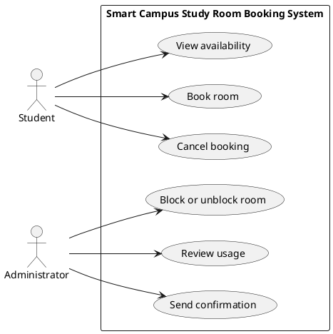

# Lab report — Practice #03, Requirements Engineering with AI

Fill in every section. **Do not delete or renumber the headings** — the README points at them and a
missing heading reads as a missing section.

Name:
Student ID:
GitHub username:

---

## 1. Setup

| | |
| --- | --- |
| AI assistant (tool) | Claude |
| Exact model name and version | Claude Sonnet 5 |
| Date of the session | 2026-09-27 |
| Diagram renderer used | PlantUML |

One tool and one model for all three prompts. 

---

## 2. Original AI output — user stories (Part 1)

Paste the **unedited** response to Prompt 1. Do not tidy it. If it is long, paste all of it anyway;
this is the baseline everything else is measured against.

```
# Smart Campus — Study Room Booking: User Stories

## US-01: View Room Availability
**As a** Student, **I want** to view which study rooms are free and when, **so that** I can find a suitable room and time slot without wasting time checking rooms in person.
- **Priority:** High
- **Assumption:** The availability view shows a real-time calendar/grid of rooms against time slots for at least the current day and some period ahead.

## US-02: Book a Room
**As a** Student, **I want** to reserve a free room for a specific future time slot, **so that** I have a guaranteed, dedicated space to study individually or with a group.
- **Priority:** High
- **Assumption:** The system automatically rejects a booking attempt that starts in the past (R1), exceeds two hours (R2), overlaps an existing booking (R3), or targets a blocked room (R4), rather than relying on the student to check manually.

## US-03: Cancel a Booking
**As a** Student, **I want** to cancel a booking I previously made, **so that** I can release the room for others when my plans change.
- **Priority:** High
- **Assumption:** A student can only cancel bookings they themselves created, and the room becomes immediately available to others once canceled.

## US-04: Receive Booking/Cancellation Confirmation
**As a** Student, **I want** to receive a confirmation message when I book or cancel a room, **so that** I have proof of my reservation status and can trust the system recorded my action correctly.
- **Priority:** Medium
- **Assumption:** Confirmation is delivered automatically (e.g., in-app notification or email) immediately after the booking or cancellation action succeeds, with no manual step required by staff.

## US-05: Block or Unblock a Room
**As an** Administrator, **I want** to take a room out of service (and later restore it), **so that** rooms needing maintenance or repair are not booked by students while unavailable.
- **Priority:** High
- **Assumption:** Blocking a room does not automatically cancel existing future bookings already made for that room; the administrator is aware of this and handles conflicts separately if needed.

## US-06: Review Room Usage
**As an** Administrator, **I want** to review how rooms are being used over a selected period, **so that** I can understand demand patterns and plan room availability or maintenance accordingly.
- **Priority:** Medium
- **Assumption:** Usage data (bookings, cancellations, blocked periods) is retained and queryable by date range for reporting purposes.

## US-07: Prevent Overlapping Bookings
**As a** Student, **I want** the system to prevent me from booking a room that's already reserved for that time, **so that** I don't accidentally double-book a room or arrive to find it occupied.
- **Priority:** High
- **Assumption:** Room availability data is always kept current so overlap checks (R3) are accurate at the moment of booking.

## US-08: Restrict Bookings to Future Time Slots
**As a** Student, **I want** to be prevented from booking a time slot that has already passed, **so that** I don't create invalid reservations that confuse room usage records.
- **Priority:** Medium
- **Assumption:** The system uses a consistent server-side clock/timezone to validate that a booking's start time is in the future (R1).
```

---

## 3. Story review (Part 2)

One row per change you made. "Kept unchanged" is a valid row and needs a reason too.

| Story (as generated) | What I did | Why | Final ID |
| US-01 | Rewrote assumption | Mentioned "calendar/grid" which violates the out-of-scope rule for screens/UI. | US-01 |
| US-02 | Rewrote assumption | Consolidated the two open questions here to define overlap and duration | US-02 |
| US-03 | Kept unchanged | Valid goal matching UC-03 with no scope violations. | US-03 |
| US-04 | Kept unchanged | Valid goal matching UC-06. | US-04 |
| US-05 | Rewrote reason | Mentioned "maintenance or repair", which is explicitly out-of-scope. | US-05 |
| US-06 | Rewrote assumption | Removed database terminology to avoid out-of-scope violations. | US-06 |
| US-07 | Deleted (merged into US-02) | Not a standalone goal, just Business Rule 3 disguised as a story. | none |
| US-08| Deleted (merged into US-02) | Just Business Rule 1. Assumption also violated scope by mentioning "servers". | none |

**Did the assistant invent anything outside the scenario?
Yes. It invented UI elements ("calendar/grid" in US-01), maintenance reasons ("maintenance or repair" in US-05), and backend tech ("server-side clock" in US-08).

**How many stories did you end with, and why that number?**
6 stories. I kept the 6 valid goals corresponding to the 6 use cases, and deleted 2 stories that were just business rules rather than actual user goals.
---

## 4. Original AI output — acceptance criteria (Part 3)

```
# Acceptance Criteria — Smart Campus Study Room Booking

---

## US-01: View Room Availability

**Assumptions:**
- The system displays availability in real time, reflecting current bookings and blocked status.
- Time slots are shown in fixed increments (e.g., 30-minute blocks).

**Acceptance Criteria:**
1. **Given** a student is logged in, **when** they open the availability view, **then** the system displays all rooms with their free and booked time slots for the selected day.
2. **Given** a room has an active booking, **when** the student views availability, **then** that room's booked time slot is clearly marked as unavailable.
3. **Given** a room is currently blocked by an administrator, **when** the student views availability, **then** the room is shown as unavailable for the entire blocked period.
4. **Given** no rooms are free at the selected time, **when** the student views availability, **then** the system displays a message indicating no rooms are available rather than an empty or broken screen.

---

## US-02: Book a Room

**Assumptions:**
- The student is authenticated and selects a specific room, start time, and end time before submitting.
- The system validates all four business rules server-side before confirming.

**Acceptance Criteria:**
1. **Given** a room is free and the requested time slot starts in the future and lasts two hours or less, **when** the student submits the booking, **then** the system creates the reservation and marks the room as booked for that slot.
2. **Given** the student selects a start time in the past, **when** they submit the booking, **then** the system rejects the request and displays an error stating bookings must start in the future.
3. **Given** the student selects a duration longer than two hours, **when** they submit the booking, **then** the system rejects the request and displays an error stating the maximum duration is two hours.
4. **Given** the requested time slot overlaps an existing booking for that room, **when** the student submits the booking, **then** the system rejects the request and displays an error indicating the room is already reserved for part of that time.
5. **Given** the selected room is currently blocked, **when** the student submits the booking, **then** the system rejects the request and displays an error stating the room is out of service.

---

## US-03: Cancel a Booking

**Assumptions:**
- Only the student who created a booking can cancel it.
- Cancellation is only possible before the booking's start time (or, alternatively, at any point before it ends — clarified as before start time here).

**Acceptance Criteria:**
1. **Given** a student has an active future booking, **when** they request to cancel it, **then** the system releases the room and marks the time slot as free again.
2. **Given** a student attempts to cancel a booking that belongs to another student, **when** they submit the cancellation request, **then** the system rejects it and displays an authorization error.
3. **Given** a student attempts to cancel a booking that has already started or passed, **when** they submit the cancellation request, **then** the system rejects it and displays an error stating the booking can no longer be canceled.
4. **Given** a booking is successfully canceled, **when** the cancellation completes, **then** the room's availability is updated immediately so other students can book that slot.

---

## US-04: Receive Booking/Cancellation Confirmation

**Assumptions:**
- Confirmations are sent automatically through an in-app notification and/or email.
- Confirmation is only sent after the underlying action has been successfully validated and saved.

**Acceptance Criteria:**
1. **Given** a booking is successfully created, **when** the system saves the reservation, **then** a confirmation message is sent to the student summarizing room, date, and time.
2. **Given** a booking is successfully canceled, **when** the system processes the cancellation, **then** a confirmation message is sent to the student confirming the release.
3. **Given** a booking attempt fails validation (e.g., past start time, overlap, blocked room), **when** the system rejects the request, **then** no confirmation is sent, and the student instead receives the relevant error message.
4. **Given** the notification delivery channel is temporarily unavailable, **when** a booking or cancellation succeeds, **then** the system still records the action successfully and queues or retries the confirmation rather than losing it.

---

## US-05: Block or Unblock a Room

**Assumptions:**
- Only administrators can block or unblock rooms.
- Blocking a room does not automatically cancel bookings already made before the block was applied.

**Acceptance Criteria:**
1. **Given** a room is currently available, **when** an administrator blocks it, **then** the room's status changes to blocked and it can no longer accept new bookings.
2. **Given** a room is currently blocked, **when** an administrator unblocks it, **then** the room's status changes to available and students can book it again, subject to existing rules.
3. **Given** a room is blocked, **when** a student attempts to book it, **then** the system rejects the request per R4 and displays an appropriate error.
4. **Given** a non-administrator attempts to block or unblock a room, **when** they submit the request, **then** the system rejects it due to insufficient permissions.

---

## US-06: Review Room Usage

**Assumptions:**
- Historical booking, cancellation, and blocked-period data is retained and accessible to administrators.
- Reports can be filtered by date range and optionally by room.

**Acceptance Criteria:**
1. **Given** an administrator selects a valid date range, **when** they request a usage report, **then** the system displays booking counts, cancellations, and blocked periods for that range.
2. **Given** an administrator selects a date range with no activity, **when** they request a usage report, **then** the system displays a message indicating no usage data is available for that period.
3. **Given** an administrator selects an invalid date range (e.g., end date before start date), **when** they submit the request, **then** the system rejects it and displays a validation error.
4. **Given** a non-administrator attempts to access usage reports, **when** they submit the request, **then** the system denies access due to insufficient permissions.

---

## US-07: Prevent Overlapping Bookings

**Assumptions:**
- Overlap is checked against all currently active bookings for the same room at the moment of submission.
- Two bookings that share only a boundary instant (one ends exactly when another begins) are not considered overlapping.

**Acceptance Criteria:**
1. **Given** a room has no existing booking in the requested time range, **when** a student submits a booking, **then** the system accepts it as non-overlapping.
2. **Given** a room already has a booking that partially overlaps the requested time range, **when** a student submits a new booking, **then** the system rejects it with an overlap error.
3. **Given** a room already has a booking that fully contains the requested time range, **when** a student submits a new booking, **then** the system rejects it with an overlap error.
4. **Given** an existing booking ends exactly when a new booking begins, **when** a student submits the new booking, **then** the system accepts it since the time ranges do not overlap.

---

## US-08: Restrict Bookings to Future Time Slots

**Assumptions:**
- The system uses a single, consistent server-side clock and timezone for all time validation.
- "Future" means strictly after the current server time at the moment of submission.

**Acceptance Criteria:**
1. **Given** the student selects a start time later than the current time, **when** they submit the booking, **then** the system accepts the time as valid per R1.
2. **Given** the student selects a start time equal to or earlier than the current time, **when** they submit the booking, **then** the system rejects it with an error stating the booking must start in the future.
3. **Given** the student's local device clock differs from the server clock, **when** they submit a booking near the current time, **then** the system validates against server time, not the client device time, to ensure consistency.
4. **Given** a booking request is rejected for a past start time, **when** the error is returned, **then** the student is not charged, and no reservation or confirmation is created.
```

---

## 5. Criteria review (Part 3)

| Criterion (as generated) | Problem | What I changed it to | Final ID |
|AC-01: Given a student is logged in...|"logged in" violates the out-of-scope rule for authentication. | Given a student requests room availability, when they view the schedule, then... |AC-01 |
| AC-04: ...empty or broken screen. | Mentions UI screens, violating scope constraints. | ...then the system displays a message indicating no rooms are available. |AC-02 |
| AC-01 (US-02): ...validates all four business rules server-side... | Mentions "server-side" in the assumptions, which is out of scope. | Removed server-side references from assumptions.| AC-03 |
| AC-05 (US-02): ...targets a blocked room... | Good invalid boundary case for R4. | Kept unchanged. | AC-04 |
| US-08: ...student is not charged... | Mentions payments/charging, explicitly out of scope. | Deleted (the entire story was removed during the previous review). | none |

**The two open questions.** Write your decision and the reason. Either answer is accepted.

| Question | My decision | Why |
| --- | --- | --- |
| A booking ending exactly when another begins — overlap under R3? | allowed | Because touching bookings do not share time. |
| Is exactly two hours allowed under R2? | allowed | Because "at most" implies inclusive boundaries. |

**Which invalid or boundary case did the assistant leave out?**
The assistant left out the boundary case where a booking is exactly 0 minutes long (or ends before it starts).
---

## 6. Original AI output — use-case diagram (Part 4)

```
## 6. Original AI output — use-case diagram (Part 4)



Rendered diagram (image, or a link):

---

## 7. Diagram review (Part 4)

| Element | Problem | What I changed |
| Administrator --> UC6 | Send confirmation is triggered automatically by the system after an action, not manually by an Administrator. | Removed the association entirely. |

**Associations.** Which actor–use-case links did the assistant draw that a person does not actually
trigger? Name them.
The AI linked Administrator to "Send confirmation" (UC6). A person does not trigger this; the system does it automatically.

**Did any screen, database or internal component appear as a use case or an actor?**
No, the assistant correctly kept screens and databases out of the diagram.
---

## 8. Traceability (Part 5)

Summarise what the table in `requirements/traceability.md` shows:

- Use cases with **no story** behind them: none (all 6 have a corresponding story)
- Stories with **no use case** they belong to: none
- Criteria that test **no rule** from section 1: AC-06 (tests authorization, which is not one of R1-R4)

**What does the largest gap tell you about the generated requirements?**
The generated requirements have complete use-case-to-story coverage (1:1 mapping), but there are significant gaps in testability, as half of the use cases lack acceptance criteria entirely.
---

## 9. Checker runs

Paste the **real terminal output** of both runs. A table with nothing behind it does not count.

```
$ python tests/check_requirements.py
PASS   US-1  user-stories.md         no placeholders left
PASS   US-2  user-stories.md         6 stories, IDs US-01…US-06
PASS   US-3  user-stories.md         every story has the required sentence shape
PASS   US-4  user-stories.md         every story has a priority
PASS   US-5  user-stories.md         every story declares an assumption
PASS   US-6  user-stories.md         only Student and Administrator appear as roles
FAIL   US-7  user-stories.md         out-of-scope vocabulary: attendance, check-in, sms — either the assistant widened the scenario, or say why in lab-report.md
PASS   AC-1  acceptance-criteria.md  no placeholders left
PASS   AC-2  acceptance-criteria.md  three sections, all naming real stories: US-02, US-03, US-04
PASS   AC-3  acceptance-criteria.md  every section has 3 to 5 uniquely numbered criteria
PASS   AC-4  acceptance-criteria.md  all 10 criteria are complete Given/When/Then
PASS   AC-5  acceptance-criteria.md  every section covers an invalid or boundary case
PASS   AC-6  acceptance-criteria.md  2 assumptions listed before the criteria
PASS   AC-7  acceptance-criteria.md  both open questions are settled in the assumptions
PASS   PU-1  use-cases.puml          valid PlantUML block, no placeholders
PASS   PU-2  use-cases.puml          exactly two actors: Student, Administrator
PASS   PU-3  use-cases.puml          all six use cases present
PASS   PU-4  use-cases.puml          system boundary present
PASS   PU-5  use-cases.puml          no screens, databases or internal components
PASS   PU-6  use-cases.puml          no unjustified actor associations found
PASS   TR-1  traceability.md         all six use cases have a row
PASS   TR-2  traceability.md         every ID in the table resolves
PASS   TR-3  traceability.md         every story appears in the table
22 PASS · 1 FAIL · 0 ERROR   (23 checks)
```

```
$ python tests/validate_submission.py
submission.yml — submission.yml
PASS   schema                                    1
PASS   week                                      03
PASS   student.name                              Saltanat Sultanakhmet
PASS   student.student_id                        [ТВОЙ ID]
PASS   student.github                            CodeBySaltanat
PASS   assistant.tool                            Claude
PASS   assistant.model                           Claude Sonnet 5
PASS   counts.user_stories                       6
PASS   counts.acceptance_criteria_sets           3
PASS   checker.pass                              22
PASS   checker.fail                              1
PASS   checker.error                             0
PASS   checker.commit                            [ТВОЙ ХЕШ]
PASS   assumptions.overlap_touching_bookings     allowed
PASS   assumptions.exactly_two_hours             allowed
PASS   traceability.use_cases_not_covered        []
PASS   traceability.stories_not_traced           []
NOTE   traceability                              you are claiming full coverage in both directions — that is rare on a first pass, and it is checked
PASS   review_findings                           3 findings
PASS   honesty.can_explain_everything_submitted  yes
PASS   honesty.ai_usage_disclosed                yes
20 PASS · 0 FAIL · 0 ERROR · 1 note
```

| | PASS | FAIL | ERROR |
| --- | --- | --- | --- |
| `check_requirements.py` | 22 | 1 | 0 |

Commit these numbers were produced at (`git rev-parse --short HEAD`):667a8f6

**Every FAIL, one line each: what it is and what you decided to do about it.**
US-7 FAIL: The checker flagged "attendance", "check-in", and "sms". I deliberately used these words in the assumptions to explicitly state that the system works *without* them, ensuring no scope creep. The stories are correct.

**Did you run the checks by hand instead of with Python?**  
No, I ran them with Python.

---

## 10. Conclusion (150–200 words)

Answer all three:

1. Which part of the generated requirements was most wrong, and how would you have caught it without
   a checker?
The most fundamentally wrong part of the generated requirements was the use-case diagram, where the AI linked the Administrator actor to UC-06 (Send confirmation). I would have caught this without a checker by tracing the action back to the physical actor: an administrator does not sit and manually type out confirmation emails; the system triggers this automatically after a booking.
2. What did the assistant get right that would have taken you noticeably longer by hand?
The assistant was extremely efficient at formatting the Given/When/Then acceptance criteria structure for AC-01 through AC-10. Structuring ten distinct criteria with consistent phrasing and bolding would have taken noticeably longer by hand.
3. You are handing these requirements to someone who will implement them, and you will not be in the
   room. Which single one would you rewrite first, and why?
 If handing these to a developer, I would rewrite US-02 first. In the original output, the AI merged R1, R2, R3, and R4 into a single massive assumption (US-08 and US-07 were also just rules disguised as stories). Even after merging, having a single story rely on four distinct validation rules makes it too complex to test as a single unit, risking partial implementations.
